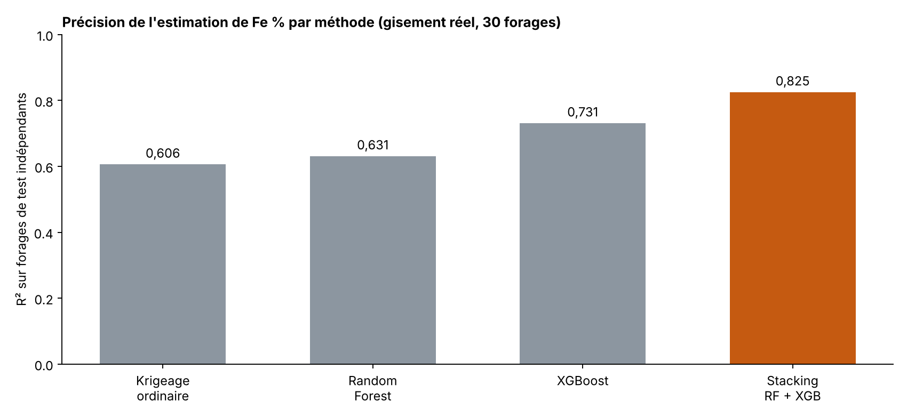
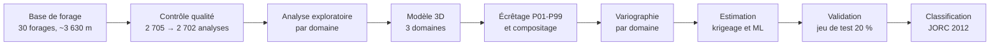
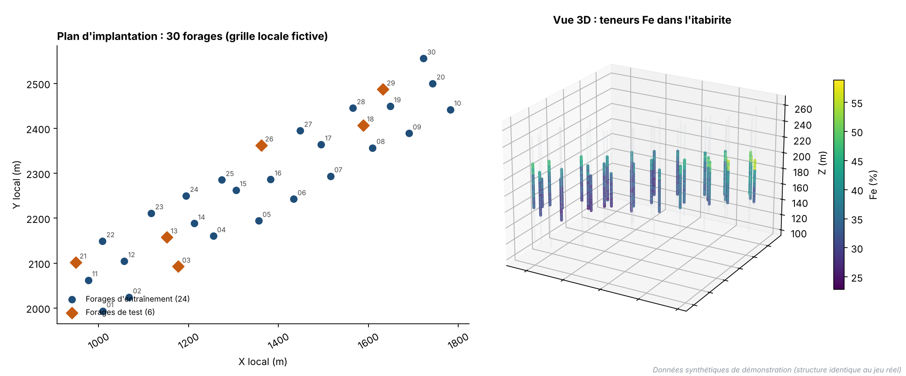
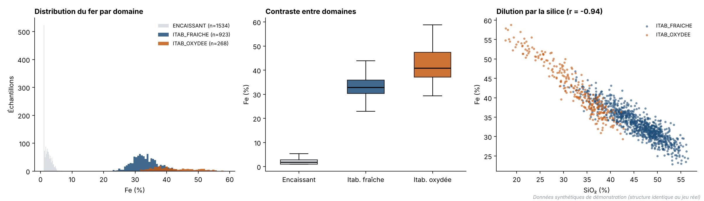
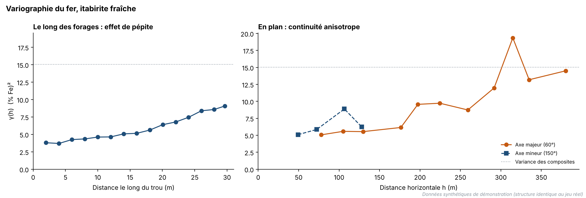
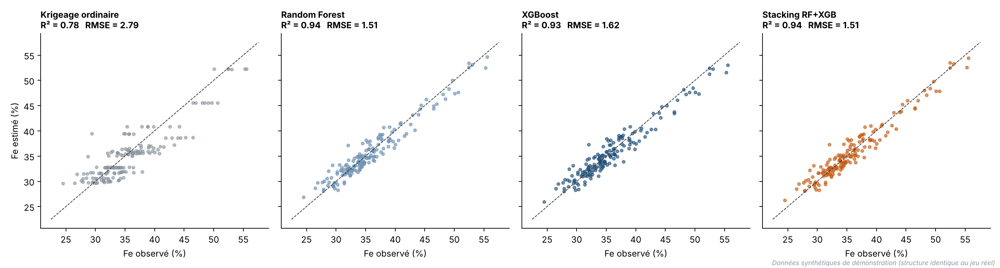
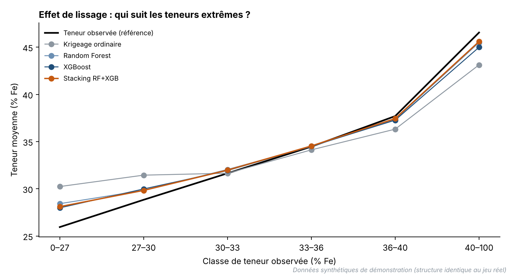
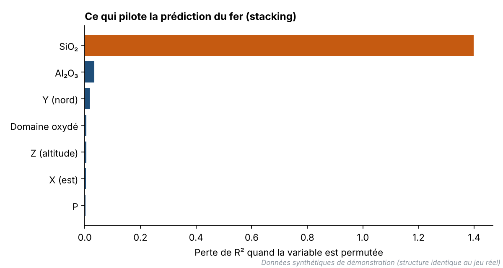

# Estimer un gisement de fer à partir de 30 forages : krigeage et Machine Learning

[](https://github.com/emmanuelnoualeu/estimation-fe-krigeage-ml/actions/workflows/pipeline.yml)


> - **Le problème :** le krigeage ordinaire lisse les teneurs d'un gisement de fer rubané (BIF). Il sous-estime le minerai riche et surestime le pauvre.
> - **Les données :** 30 forages, ~3 630 m, ~2 700 échantillons analysés (Fe, SiO₂, Al₂O₃, P), gisement de BIF, Sud-Cameroun.
> - **La méthode :** modèle géologique 3D, variographie par domaine, puis comparaison sur un jeu de test indépendant : krigeage, Random Forest, XGBoost et stacking.
> - **Le résultat :** le R² passe de **0,606 à 0,825**, pour un inventaire de **102,1 Mt à 31,4 % Fe**, dont **58,2 Mt en Mesurée + Indiquée** (JORC 2012).



---

## Pourquoi c'est important

Dans un projet minier, l'estimation des teneurs fixe le tonnage au-dessus de la coupure, la séquence d'extraction et, au bout du compte, la valeur du projet. Une estimation trop lisse peut classer en stérile du minerai exploitable, ou l'inverse. Dans ce projet, je montre comment **mesurer ce biais** et **le réduire**, sans renoncer au cadre géostatistique qu'exigent les codes de déclaration (JORC, NI 43-101).

## Les chiffres clés (gisement réel)

| | Krigeage ordinaire | Random Forest | XGBoost | **Stacking RF + XGB** |
|---|---|---|---|---|
| R² validation croisée (5 plis) | 0,606 | 0,711 | 0,769 | **0,848** |
| R² jeu de test (20 %, 361 composites) | 0,606 | 0,631 | 0,731 | **0,825** |
| RMSE (% Fe) | 5,34 | 5,14 | 4,39 | **3,54** |
| MAE (% Fe) | 4,10 | 3,74 | 3,16 | **2,45** |
| Pente estimé / observé | 0,57 | – | – | **0,83** |

**[▶ Lire l'étude détaillée](https://emmanuelnoualeu.github.io/projets/gisement-fer/)** : contrôle qualité, valeurs aberrantes, compositage, variographie, krigeage, machine learning et classification, avec tous les tableaux du mémoire.

| Domaine géologique (modèle 3D) | Volume |
|---|---|
| Encaissant | 45,6 Mm³ |
| Itabirite fraîche | 6,94 Mm³ |
| Itabirite oxydée | 0,81 Mm³ |

| Catégorie JORC 2012 (coupure 25 % Fe) | Tonnage |
|---|---|
| Mesurée + Indiquée | 58,2 Mt |
| Inférée | 43,9 Mt |
| **Total** | **102,1 Mt à 31,4 % Fe** |

## La chaîne de traitement des données (gisement réel)

Avant la moindre estimation, la base de forage a été reconstruite, contrôlée et préparée. C'est cette étape qui rend les résultats défendables.



| Étape | Ce qui a été fait | Résultat | Outils |
|---|---|---|---|
| 1. Base de forage | Assemblage des tables Collar, Survey, Geology et Assay | 30 forages, environ 3 630 m | Isatis.neo |
| 2. Contrôle qualité | Cohérence des quatre tables et des intervalles d'échantillonnage | 2 705 analyses brutes ramenées à **2 702 analyses XRF exploitables** ; anomalies d'intervalles corrigées | Isatis.neo |
| 3. Analyse exploratoire | Statistiques et histogrammes par domaine, relations entre Fe, SiO₂, Al₂O₃ et P | Relation inverse Fe-SiO₂ mise en évidence | Isatis.neo, Python |
| 4. Modèle géologique 3D | Modélisation des contacts à partir des logs et des teneurs | 3 domaines : encaissant 45,6 Mm³, itabirite fraîche 6,94 Mm³, itabirite oxydée 0,81 Mm³ | Leapfrog Geo |
| 5. Écrêtage et compositage | Teneurs aberrantes en Fe écrêtées entre les percentiles 1 et 99 ; régularisation à longueur fixe dans chaque domaine | **1 818 composites de 2 m** | Isatis.neo |
| 6. Variographie | Variogrammes directionnels par domaine | Anisotropie NW-SE (~135°), pépite quasi nulle, portées de 150 à 300 m | Isatis.neo |
| 7. Estimation | Krigeage ordinaire par domaine, puis Random Forest, XGBoost et stacking ; modèle de blocs | R² de 0,606 (krigeage) à 0,825 (stacking) | Isatis.neo, Python, Surpac |
| 8. Validation | Validation croisée à 5 plis et jeu de test indépendant de 20 % (361 composites, tirage stratifié par type de roche) | Stacking : RMSE 3,54 % Fe contre 5,34 pour le krigeage ; pente 0,83 contre 0,57 | Python, Excel, Power BI |
| 9. Classification | Efficacité de krigeage, densité d'échantillonnage, confiance géologique ; courbe tonnage-teneur | 102,1 Mt à 31,4 % Fe, dont 58,2 Mt en Mesurée + Indiquée | Surpac, Excel |

Détail de chaque étape et de ses paramètres : [docs/METHODOLOGIE.md](docs/METHODOLOGIE.md).

---

## La démarche en 6 étapes

> Les données de ce gisement sont la propriété de MuCoTech SARL et ne sont pas publiées. Les figures ci-dessous sont produites par le code de ce dépôt sur un **jeu synthétique de même structure** (30 forages, 3 domaines, continuité anisotrope ; coordonnées et orientation fictives), pour que chacun puisse reproduire la démarche. Leurs scores illustrent la méthode et ne remplacent pas les résultats réels donnés plus haut.

### 1. Comprendre la base de forages
Implantation, profondeurs, répartition des domaines. Six forages entiers sont tenus à l'écart dès le départ : ils servent uniquement à juger les méthodes.



### 2. Explorer les données
Les trois domaines ont des distributions de fer très différentes : on estime donc **domaine par domaine**. La silice dilue le fer, et cette relation est la clé du gain obtenu par le Machine Learning.



### 3. Modéliser la continuité spatiale
Les variogrammes montrent une continuité plus longue selon l'axe majeur. Sur le gisement réel, l'anisotropie est orientée NW-SE (~135°), l'effet de pépite est quasi nul et les portées vont de 150 à 300 m selon le domaine. Ces paramètres orientent l'ellipsoïde de recherche du krigeage.



### 4. Estimer avec quatre méthodes
Krigeage ordinaire 3D par domaine, Random Forest, XGBoost et un **stacking** qui combine les deux derniers.



### 5. Valider là où personne n'a foré
L'effet de lissage se lit directement : dans les classes extrêmes, le krigeage s'éloigne de la teneur réelle, alors que les modèles ML la suivent de près.



### 6. Expliquer le modèle
La silice porte l'essentiel de la prédiction. Le résultat est cohérent avec la minéralogie des BIF (dilution du fer par le quartz) : le modèle apprend de la géologie, pas du bruit.



---

## Ce que j'en retiens

- **Le Machine Learning ne remplace pas le krigeage, il le complète.** Le krigeage reste traçable, auditable et accepté pour la déclaration des ressources. Le ML affine localement la teneur et sert de contrôle indépendant.
- **Un bon score dépend d'une validation honnête.** Dans le mémoire, le jeu de test est tiré au hasard parmi les composites, si bien que deux composites voisins d'un même forage peuvent se retrouver de part et d'autre. Ce dépôt va plus loin : le code de démonstration tient à l'écart des forages entiers, ce qui donne une mesure plus prudente.
- **Le gain du ML dépend de la chimie disponible.** Pour un modèle de blocs, SiO₂ doit d'abord être estimée en chaque bloc. Le gain mesuré sur échantillons est donc une borne haute.

Limites du travail et pistes d'amélioration : voir [docs/METHODOLOGIE.md](docs/METHODOLOGIE.md#9-limites-et-suite).

---

## Reproduire l'étude

```bash
git clone https://github.com/emmanuelnoualeu/estimation-fe-krigeage-ml.git
cd estimation-fe-krigeage-ml
pip install -r requirements.txt
python src/run_all.py          # données synthétiques -> estimation -> 7 figures (~1 min)
pytest -q tests                # 5 tests unitaires
```

Pour suivre l'analyse pas à pas avec les commentaires, ouvrez le notebook [notebooks/analyse_30_forages.ipynb](notebooks/analyse_30_forages.ipynb) : GitHub l'affiche directement, avec ses résultats.

```
estimation-fe-krigeage-ml/
├── README.md
├── docs/METHODOLOGIE.md             # chaque étape, chaque paramètre, chaque limite
├── notebooks/analyse_30_forages.ipynb
├── src/
│   ├── donnees_synthetiques.py      # génère la base de 30 forages de démonstration
│   ├── analyse.py                   # compositage, variographie, krigeage, ML, métriques
│   ├── figures.py                   # toutes les figures du dépôt
│   └── run_all.py                   # exécute l'étude de bout en bout
├── tests/test_analyse.py
├── data/                            # base synthétique + métriques de test
└── figures/
```

**Outils :** Leapfrog Geo (modèle 3D) · Isatis.neo (variographie, krigeage) · Surpac · Python (pandas, scikit-learn, XGBoost, PyKrige, matplotlib).

---

## Travailler avec moi

J'aide les **sociétés d'exploration, les bureaux d'études et les chercheurs en géosciences** à tirer des décisions fiables de leurs données de forage.

| Ce que vous avez | Ce que je livre |
|---|---|
| Des fichiers de forage hétérogènes (Excel, CSV, exports de logiciels) | Une base propre et validée : collars, surveys, analyses, lithologie, avec un rapport des anomalies |
| Des analyses de laboratoire à vérifier | Un contrôle QA/QC chiffré, avec graphiques et recommandations |
| Des forages et une interprétation géologique | Un modèle géologique 3D par domaines et des sections interprétées |
| Un besoin d'estimation des teneurs | Variographie, krigeage par domaine et comparaison avec le Machine Learning, validée sur des forages indépendants |
| Des données géochimiques multi-éléments | Analyse statistique, corrélations, classification et cartes de teneurs |
| Un rapport, un mémoire ou une présentation à produire | Des figures claires et un rapport technique rédigé en français ou en anglais |

*Pour une déclaration publique de ressources (JORC, NI 43-101), je prépare les données, les modèles et la documentation technique ; la signature reste celle de votre Personne Compétente ou Personne Qualifiée.*

**Me contacter :** [Portfolio](https://emmanuelnoualeu.github.io) · [LinkedIn](https://www.linkedin.com/in/emmanuel-noualeu-b78bba24b/) · [Upwork](https://www.upwork.com/freelancers/~0146b1a5dfeefdd395) · [emmanuelnoualeu@gmail.com](mailto:emmanuelnoualeu@gmail.com)

Décrivez-moi votre jeu de données en trois lignes : nombre de forages, substance, ce que vous cherchez à décider. Je vous réponds sous 48 h avec une proposition de démarche.

---

## English summary

**Iron ore resource estimation from 30 drillholes: ordinary kriging vs. machine learning.** BIF iron deposit, Southern Cameroon (~3,630 m drilled, ~2,700 assays). After domain-based 3D geological modelling and variography (NW-SE anisotropy, 150–300 m ranges), four estimators were compared on held-out drillholes. A Random Forest + XGBoost stacking model raised R² from 0.606 (ordinary kriging) to 0.825 (RMSE 3.54 % Fe) and reduced conditional bias. Resources were classified under JORC 2012: 102.1 Mt at 31.4 % Fe (25 % Fe cut-off), of which 58.2 Mt are Measured + Indicated. Raw data are confidential; the repository runs end-to-end on a synthetic dataset with the same structure.
**Available for freelance work:** drillhole database cleaning, QA/QC, 3D geological modelling, geostatistical and ML grade estimation, technical reporting (French and English).

---

**NOUALEU Emmanuel**, ingénieur en ingénierie minière et traitement des minerais (ENSMIP, Université de Maroua)
Code sous licence MIT. Les résultats du gisement réel sont cités à partir de mon mémoire de fin d'études (2026), réalisé chez MuCoTech SARL sous l'encadrement de M. Ambassa Alain Bertrand, du Pr Kanouo Sylvestre Nguo et du Dr Nzeukou Nzeugang Aubin.
